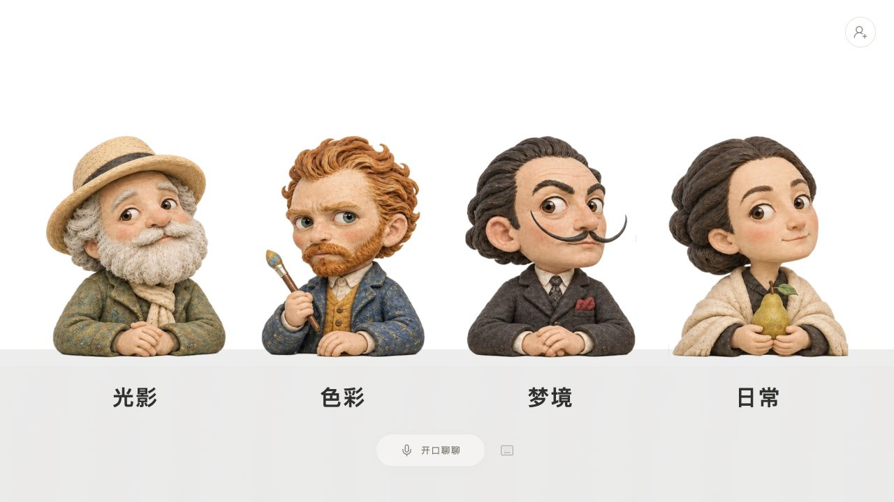

# 余光 AFTERGLOW · 艺术家晚宴

2026-11-04 更新：参考坐姿公仔餐桌，镜头退远、人物缩小、席位拉开，保留白色背景、白色桌布和“光影／色彩／梦境／日常”。正常界面保留说话入口，可展开轻量打字，右上角可添加艺术家或发起群聊；不再打开侧边聊天窗。

## 从 GitHub 下载后运行

需要 Node.js 22.6 或更新版本。终端进入项目目录后运行：

```sh
npm ci
npm run dev
```

打开终端显示的本地地址。生产构建与检查：

```sh
npm test
npm run build
npm run preview
```

构建后的 `dist/` 不提交到仓库。想使用下面的 Python 启动方式，请先运行 `npm ci` 和 `npm run build`。Python 启动需要 Python 3。

## 本机打开

双击 `打开艺术家晚宴.command`，或在此目录运行 `python3 scripts/serve.py`，打开 [http://127.0.0.1:4893/](http://127.0.0.1:4893/)。需要电脑上的 Python 3，无需重新安装 npm 依赖。关闭启动终端或按 Control+C 停止服务。

源码开发：`npm install`、`npm run dev`。检查：`npm run build`、`npm test`。`dist/` 是已构建的版本，不能直接通过 file:// 打开，需要上述本地 HTTP 服务。

## 直接聊，不用先选人

- 点击一次“开口聊聊”，按浏览器提示允许麦克风。之后每次说完停顿，就自动提交一句；回复完成后继续倾听。点击同一按钮可暂停，切到后台也会停止倾听。首次点击是浏览器启动音频的必要操作。
- 不必点击人物。光影／日落由莫奈接话，颜色由梵高接话，梦境由达利接话，生活心情由欧姬芙接话；无明确话题时延续上一位。可以直接叫名字，也可以点某个人让他优先接话，再点一次取消。
- 回复出现在人物头顶的小气泡中，并用所选音色朗读。镜头保持远景，人物不会靠近或放大。思考时显示云朵省略号。手动输入也走同一个接话流程。
- 语音播报时暂停识别，避免把设备自己的声音当作玩家的话；支持打断回复。未开启语音时不录音。
- 正常聊天不再推荐绘画、任务、关系数值或作品夹。“邀请朋友”“声音设置”这类明确要求才出现可关闭入口，用来管理人设和音色。旧版作品、记忆和相关组件保留在源文件和浏览器存档中。
- 存档保存在当前浏览器；不同地址和端口的存档独立。`?slot=qa-room` 使用独立测试存档。

## 拉艺术家一起群聊

右上角双人图标“发起群聊”→选 2–5 位艺术家→“一起聊”。也支持从来宾册中选自己创建的艺术家；不要求先改变自由聊天的席位。

- 群聊仍在同一张餐桌，短回复在人物头顶出现，沿用每位来宾自己的音色。
- 普通话题一轮最多两位接话；点名只让指定成员接话；说“大家怎么看”可听全员。回复会轮流播放，上一位播完才轮到下一位。
- 随时“打断回复”，或打字提出新问题，会取消本轮剩余发言；打开管理弹窗、切到后台或离开群聊也会停止本轮。
- 左上角群名可查看记录／继续之前的群，旁边 × 回到原来的自由聊天席位。刷新后通过“发起群聊”→“之前的群聊”继续。
- 群聊记录与每个人的单独聊天分开保存在本机；完整存档导出包含群聊记录。既有旧存档可继续使用。

本版是**玩家与多个艺术家角色的本地剧本群聊**，不是多人联网房间。当前会话轮次与发言差异来自本地规则，没有接入群聊大模型，也不会无限自动讨论。

## 当前实现边界

这是**本地规则剧本试玩**，未连接云端大模型。文字自由输入已接通，但回复来自有限的本地人设和话题规则，不能提供真正无限开放的 AI 对话。角色均为艺术家人设演绎。

朗读已支持外部音色服务与浏览器／操作系统合成音色，详见下方配置；未克隆艺术家声音。语音输入使用浏览器的 SpeechRecognition，仅在点击麦克风后启动；浏览器可能将音频交给自己的识别服务。浏览器不支持、授权失败、网络错误时可以继续打字。未验证真实人声端到端识别，也没有逐字口型。

人物是带实际 skin、4 根骨骼和混合权重的 **2.5D 公仔图像**，不是可自由旋转的完整三维人物。环境及桌布为三维几何。每位人物有 Idle、Talk、Curious、Excited、Upset 五个独立动作；没有全身走动。人物贴图已更新为坐姿、双手搭在桌边。

## 文件

- `src/`：React + TypeScript + Three.js，组件、存档、语音和游戏状态分开。
- `blender/`：可编辑的场景和每位人物 `.blend`；`build_assets.py` 为复现脚本。
- `public/models/`：独立环境及角色 GLB。
- `public/art/`：人物贴图；旧版插画背景保留为源素材，当前画面不使用。
- `assets-source/`：原始参考生成素材及提示。
- `verification/`：构建、测试、骨架验证及实际浏览器截图。

重新导出：`/Applications/Blender.app/Contents/MacOS/Blender --background --python blender/build_assets.py`，然后 `npm run build`。

## 2026-11-05：角色档案与玩家上传

五位内置人物的性格、开场与简短回应已调整。完整模型角色卡与原创对白示例在 [docs/全角色与玩家上传](docs/全角色与玩家上传/README.md)；这些提示尚未接入本地聊天引擎。

点击主画面右上角“人物＋”图标，直接添加艺术家；也可以输入或说“打开来宾册”，点“看看来宾册”→“创建我的艺术家”。支持 PNG／JPG／WebP 参考图（5 MB）、TXT／MD 资料与本游戏 JSON 角色卡（100 KB）。表单自动保存本机草稿；文字角色卡可下载。参考图只保存在档案中，桌边明确暂用统一示例形象。人设、外观、声音独立；未接模型与新形象生成；外部音色服务已接入。满五席时新角色只加入来宾册。

上传文字用于档案及有限预写对白，不会自动训练模型。TXT 不自动推断人物，JSON 只读取已知字段，其他游戏操作、身份 ID、声音和聊天记录不会随角色卡导入。角色卡导出不含参考图、声音与聊天；完整存档仍走原有导出功能。

## 2026-11-05：外部音色服务

本机已配置用户提供的音色服务。右上角“人物＋”→“设置来宾声音”，可为每位内置／自定义艺术家独立选择平台、模型、系统音色或服务音色库，调整语速、音调并试听。餐桌回复使用同一设置；生成中与播放中都可打断，失败提示后回退设备音色。旧存档中明确选过的设备音色继续保留。

从仓库重新运行时，复制 `.env.example` 为 `.env.local`，填写 `VITE_VOICE_SERVICE_URL`，然后重启开发服务或重新构建。该地址是浏览器可见的服务地址，不是密钥；密钥应由语音服务端管理，不填写在前端环境变量中。没有配置服务时继续使用设备音色。具体接口与验证记录见 [语音接入说明](docs/语音服务接入.md)。

仅把当前朗读台词、音色和合成参数发送给服务及所选平台，服务可能保留合成记录；不发送完整聊天、上传原图或原始资料，也不读取其他用户的合成历史。本次没有接入声音克隆或训练。语音输入继续使用浏览器识别，聊天内容继续由本地规则生成，接通 TTS 不等于接通对话模型。

内网地址要求玩家设备能访问相同网络。当前 HTTP 服务可供本机 HTTP 试玩使用；HTTPS 网站需要可访问的 HTTPS 音色接口或服务端代理，不能直接把内网 HTTP 地址当成公共部署接口。

## 剧本、人设与上传

- [全角色性格与玩家上传](docs/全角色与玩家上传/README.md)
- [莫奈人设方案](docs/莫奈人设方案/README.md)
- [许白示例角色卡](docs/全角色与玩家上传/许白.artist.json)



本仓库不包含玩家浏览器中的私人聊天、收藏或上传档案；这些内容仍保存在玩家本机浏览器。`verification/` 里的许白为虚构测试角色。素材目录包含本项目使用的公仔图像与 Blender 场景源文件。
